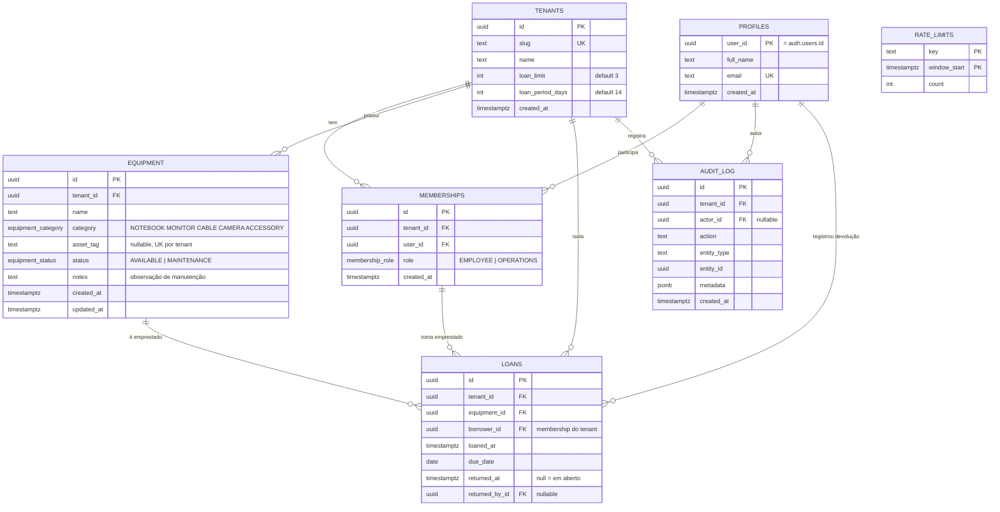

# Modelagem de dados

Modelo relacional do empresta-ai para PostgreSQL (Supabase) com Prisma, seguindo a
[ADR 001](adr/001-stack.md) (multi-tenancy por coluna, RLS deny by default, auditoria
append-only, rate limit no Postgres) e as regras do [PRD](PRD.md).

Implementação: [schema.prisma](../apps/api/prisma/schema.prisma),
[migration inicial](../apps/api/prisma/migrations/20261001000000_init/migration.sql)
(Prisma gerado + SQL bruto) e [seed.ts](../apps/api/prisma/seed.ts).

## Diagrama



`RATE_LIMITS` não se relaciona com nada: as chaves são IPs ou ids de usuário, fora de tenant.

## Decisões

**Estado derivado, não armazenado.** A situação do LAYOUT (Disponível, Emprestado, Em atraso,
Manutenção) não vira coluna única. Só o que uma pessoa define à mão fica em `equipment.status`
(`AVAILABLE`, `MAINTENANCE`). "Emprestado" e "em atraso" saem do empréstimo em aberto
(`returned_at IS NULL`) e do prazo, o que elimina a divergência entre status e empréstimo.

| Situação (LAYOUT) | Como se obtém |
|---|---|
| Manutenção | `equipment.status = 'MAINTENANCE'` |
| Emprestado / a vencer | existe loan com `returned_at IS NULL` e `due_date >= hoje` |
| Em atraso | existe loan com `returned_at IS NULL` e `due_date < hoje` |
| Disponível | `status = 'AVAILABLE'` e sem loan em aberto |

**Isolamento de tenant no próprio schema.** Chaves compostas impedem referência cruzada:
`loans (equipment_id, tenant_id)` aponta para `equipment (id, tenant_id)` e
`loans (tenant_id, borrower_id)` aponta para `memberships (tenant_id, user_id)`. Um empréstimo
não consegue ligar equipamento de um tenant a pessoa de outro, nem a quem não é membro.

**Identidade.** `profiles.user_id` é o id do Supabase Auth, com FK para `auth.users` criada
no SQL bruto (condicional, pois o schema `auth` só existe no Supabase). `profiles` é global;
o papel é por tenant em `memberships`, como na ADR 001.

**Histórico preservado.** FKs de `loans` e `audit_log` são `RESTRICT`: não se apaga equipamento,
pessoa ou tenant que tenha histórico. Aposentar um item exigiria um status novo (ver dúvidas).

## Onde cada regra é garantida

| Regra | Camada | Mecanismo |
|---|---|---|
| Um item não tem dois empréstimos em aberto | Banco | índice único parcial `loans_one_open_per_equipment` |
| Empréstimo só entre dados do mesmo tenant | Banco | FKs compostas |
| Devolução não anterior à retirada | Banco | CHECK `loans_return_after_loan` |
| Patrimônio único por tenant | Banco | `UNIQUE (tenant_id, asset_tag)` (vários nulos permitidos) |
| Limite e prazo positivos | Banco | CHECKs em `tenants` |
| Auditoria só acrescenta | Banco | triggers que rejeitam UPDATE, DELETE e TRUNCATE |
| Nada acessível a `anon`/`authenticated` | Banco | RLS ligado sem policies + `REVOKE` |
| Máximo de 3 itens por pessoa | API | `tenants.loan_limit`, na transação |
| Bloqueio por atraso | API | consulta de loans em aberto vencidos, na transação |
| Item em manutenção não é emprestado | API | checagem de `status` na transação |
| Prazo de 14 dias | API | `due_date = hoje + tenants.loan_period_days` |
| Autorização por papel | API | Guards + CASL |

Limite e bloqueio ficam na API, não em trigger: dependem de configuração do tenant e de
"hoje", e o teste de integração com Testcontainers cobre isso. Para evitar corrida (duas
solicitações simultâneas furando o limite), a transação de "solicitar" deve começar com
`SELECT ... FROM memberships WHERE tenant_id = $1 AND user_id = $2 FOR UPDATE`, serializando
as solicitações da mesma pessoa. A corrida no mesmo equipamento já é coberta pelo índice parcial.

## Consultas de referência

```sql
-- Empréstimos em aberto da pessoa (Meus empréstimos, limite, bloqueio)
SELECT * FROM loans
WHERE tenant_id = $1 AND borrower_id = $2 AND returned_at IS NULL;

-- Pessoa tem item em atraso?
SELECT EXISTS (
  SELECT 1 FROM loans
  WHERE tenant_id = $1 AND borrower_id = $2
    AND returned_at IS NULL AND due_date < (now() AT TIME ZONE 'America/Sao_Paulo')::date
);
```

## Verificação feita

A migration foi aplicada com `prisma migrate deploy` em um Postgres 16 descartável (container
local, já removido), com um `auth.users` simulado, e as restrições foram exercitadas: patrimônio
duplicado, segundo empréstimo em aberto, tomador fora do tenant, equipamento de outro tenant,
devolução antes da retirada, UPDATE/DELETE/TRUNCATE no `audit_log`, `loan_limit = 0` e acesso do
role `authenticated` (negado). Todos falharam como esperado, e a devolução seguida de novo
empréstimo passou. O seed rodou duas vezes sem duplicar. Nenhum banco real foi tocado.

Não foi verificado: execução em um projeto Supabase real e o comportamento do RLS sob JWT
(não há policies; a camada é deny all).

## Dúvidas em aberto

1. **Categoria como enum ou tabela?** Enum atende às 5 categorias do LAYOUT; acrescentar uma
   exige migration. Tabela por tenant permitiria Operações criar categorias.
2. **Aposentar equipamento.** O LAYOUT cita "inativo" na paleta, mas a v1 só tem Disponível e
   Manutenção. Falta um `RETIRED` (ou `deleted_at`) se Operações precisar baixar itens.
3. **Convites.** O cadastro é fechado por convite (ADR 001), mas não há tabela de convites: o
   fluxo ficou fora do escopo da ADR. Decidir se usa o convite nativo do Supabase Auth.
4. **Fuso do prazo.** `due_date` é uma data; "hoje" deve ser calculado em `America/Sao_Paulo`
   (as functions da Vercel rodam em UTC).
5. **Previsão de retorno da manutenção.** O LAYOUT mostra "retorna em 05/09" dentro da
   observação; hoje é texto livre em `notes`. Se precisar filtrar ou alertar, vira coluna `date`.
6. **Prisma 7.** O schema usa a sintaxe do Prisma 7 (URLs em `prisma.config.ts`, driver
   adapter). A ADR 001 cita `directUrl` do Prisma 6 e anteriores: vale uma linha de revisão lá.
